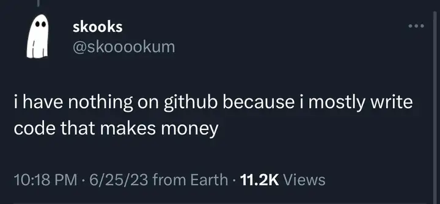

# Gabriel Cavalcanti

**A.K.A. lockstack**

---

## A bit about me

I'm a full-stack developer and Systems Analysis and Development student, working across software development and Quality Control. I build and maintain web applications, desktop software, internal platforms, APIs, and automations, from architecture and business logic to testing, deployment, and ongoing improvements.

Much of my work involves solving operational problems: integrating systems, securing access, eliminating repetitive tasks, and making everyday workflows more reliable.

## Tech stack

### Frontend

### Backend & desktop

### Cloud & databases

### Testing & CI/CD

### Tools

---

## GitHub disclaimer

Not everything worth building can be published.

